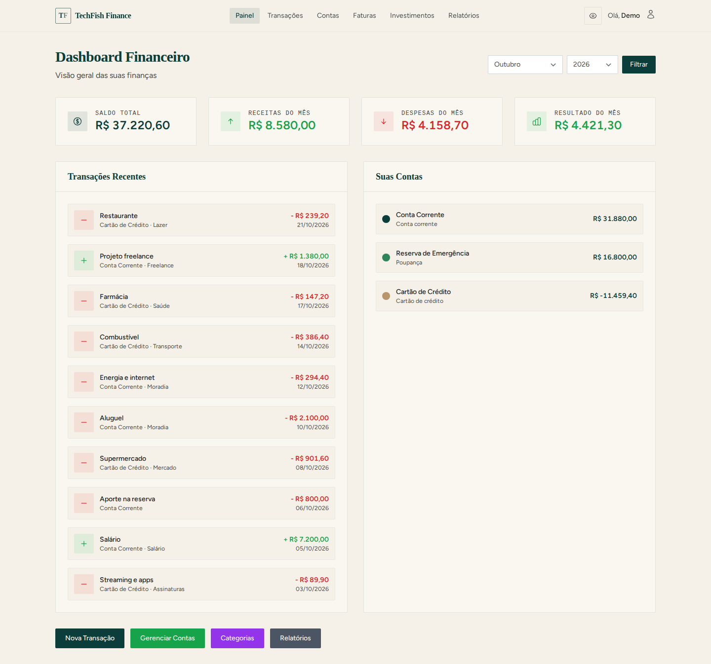
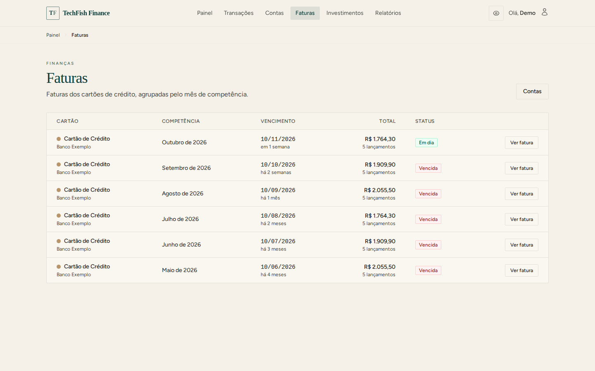
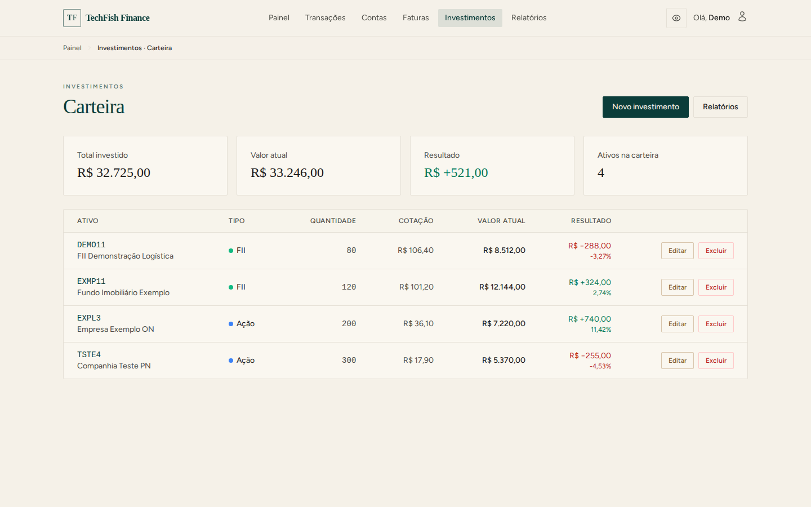
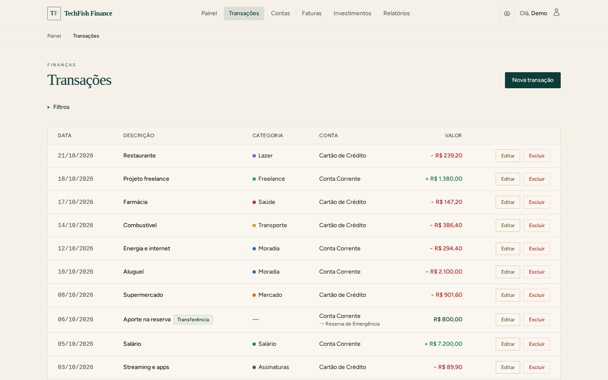
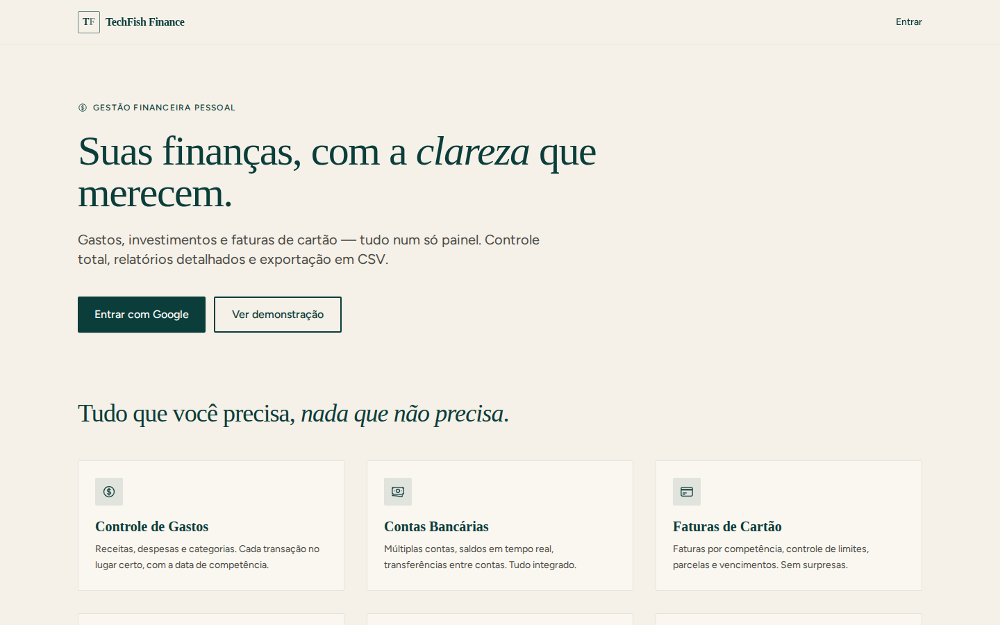

# TechFish Finance

Gestão de **finanças pessoais** e **carteira de investimentos** em Laravel: contas, transações,
faturas de cartão por competência, proventos e relatórios — com os dados de cada usuário isolados.

> *Personal finance and investment portfolio manager built with Laravel 13. Google sign-in,
> per-user data isolation, credit card bills by accrual month, dividend tracking and reports.
> Includes a one-click demo mode with fictional data.*



## Funcionalidades

**Finanças**
- Receitas, despesas e transferências entre contas, com categorias
- Contas (corrente, poupança, cartão, dinheiro) com saldo recalculado a partir das transações
- Faturas de cartão de crédito por **competência** (mês da fatura) e vencimento
- Painel mensal, relatórios e exportação em CSV
- "Ocultar valores": um clique troca todos os R$ da tela por `R$ •••••`

**Investimentos**
- Carteira de FIIs, ações, BDRs, ETFs e outros tipos configuráveis
- Posição por **custo médio** (taxas no custo), recalculada a cada compra/venda; vendas acima da posição são recusadas
- Compras e vendas, proventos (dividendos, JCP, aluguéis) e relatórios de rentabilidade

**Acesso**
- Login **somente com Google** (sem senha para vazar nem cadastro aberto)
- Perfis e permissões (RBAC), administração de usuários e desativação de contas
- **Modo demonstração**: botão "Ver demonstração" que entra numa conta com dados fictícios

## Telas

Capturadas da conta de demonstração (dados fictícios).

| Faturas por competência | Carteira de investimentos |
|---|---|
|  |  |
| **Transações** | **Página inicial** |
|  |  |

Para refazer as imagens (com o app rodando e `DEMO_MODE=true`): `scripts/screenshots.mjs`.

## Destaques técnicos

- **Isolamento de dados por usuário**: Policies em todos os recursos, consultas sempre pelo dono
  e validação de que contas/categorias referenciadas pertencem a quem está logado
  (`TransactionService::validateReferencesOwnership`). Coberto por testes de "intruso".
- **Regra de negócio fora dos controllers**: `app/Services` (faturas, relatórios, transações) e
  validação em Form Requests.
- **Segurança**: cabeçalhos de proteção (clickjacking, MIME sniffing, HSTS), proteção contra
  pré-sequestro de conta no primeiro login Google, sessão derrubada para usuário desativado.
- **SQL portável**: MySQL em produção, SQLite em memória nos testes (sem `YEAR()`/`MONTH()`).
- **Testes**: ~320 testes Feature/Unit (PHPUnit 12). A suíte é travada para nunca rodar contra o
  banco de desenvolvimento (`phpunit.xml` + guarda em `tests/TestCase.php`).

## Stack

| Camada | Tecnologia |
|---|---|
| Backend | PHP 8.3+ (Docker: 8.4), Laravel 13 |
| Frontend | Blade, Tailwind CSS 3, Alpine.js 3, Vite 5 |
| Banco | MySQL 8 · testes em SQLite em memória |
| Cache/sessão/fila | Redis |
| Autenticação | Google OAuth (Laravel Socialite) · tokens de API (Sanctum) |

## Rodando localmente (Docker)

Pré-requisitos: Docker com o plugin `docker compose`.

```bash
git clone https://github.com/eduardopeixinho/techfish-finance.git
cd techfish-finance
./setup.sh
```

O script cria o `.env`, gera a `APP_KEY`, sobe os containers, instala as dependências, roda as
migrations e os seeders e, com `DEMO_MODE=true` (padrão), cria a conta de demonstração.

| Serviço | Endereço |
|---|---|
| Aplicação | http://localhost:8000 |
| phpMyAdmin | http://localhost:8081 (root / rootsecret) |

Abra a aplicação e clique em **Ver demonstração**. Não é preciso configurar o Google.

> O container não tem Node: os assets compilados (`public/build`) estão no repositório.
> Se mudar CSS/JS, rode `npm ci && npm run build` na sua máquina.

### Login com Google (opcional)

1. Crie credenciais OAuth no [Google Cloud Console](https://console.cloud.google.com/apis/credentials).
2. Adicione `http://localhost:8000/auth/google/callback` como URI de redirecionamento.
3. Preencha `GOOGLE_CLIENT_ID` e `GOOGLE_CLIENT_SECRET` no `.env`.
4. Opcional: `GOOGLE_ALLOWED_DOMAINS` (CSV) restringe quem pode entrar.
5. Depois do primeiro login, `docker compose exec app php artisan db:seed --class=RolePermissionSeeder`
   torna o primeiro usuário real administrador.

### Modo demonstração

- `DEMO_MODE=true` mostra o botão "Ver demonstração" na página inicial e no login.
- `php artisan db:seed --class=DemoSeeder` cria (ou **reseta**) a conta demo com seis meses de dados
  fictícios. A conta demo não pode ser editada, excluída nem virar administradora.
- Em produção, deixe `DEMO_MODE=false` se não quiser uma conta compartilhada.

## Testes

```bash
docker compose exec app php artisan test
```

## Estrutura

```
app/
├── Http/Controllers/
│   ├── Finance/        # painel, transações, contas, categorias, configurações
│   ├── Investment/     # carteira, transações, proventos, tipos
│   ├── Admin/          # perfis, permissões, usuários
│   └── AuthController  # Google OAuth
├── Http/Requests/      # Form Requests (validação)
├── Models/             # Finance/, Investment/, User, Role, Permission
├── Policies/           # autorização por dono do recurso
├── Services/           # faturas, relatórios, transações
└── Support/            # Money (formatação com "ocultar valores"), PageTitle
database/seeders/       # catálogos + DemoSeeder
tests/Feature/          # Finance, Investment, Admin, Auth, Integration (isolamento)
```

## Licença

[MIT](LICENSE)
